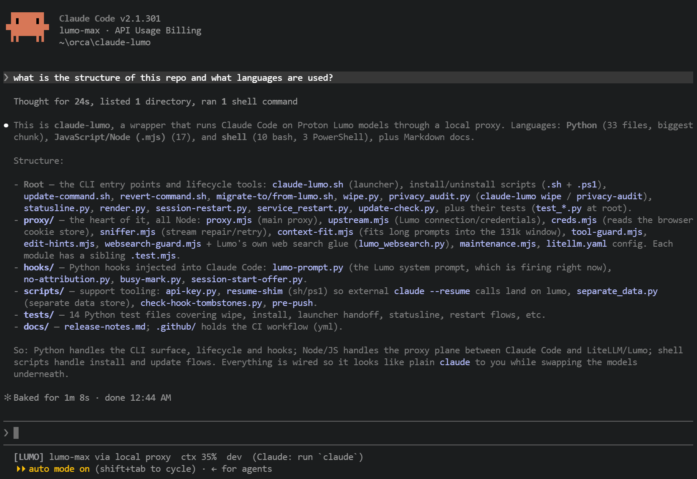

# claude-lumo

Run [Claude Code](https://claude.com/product/claude-code) on [Proton Lumo](https://proton.me/lumo) with one command.

`claude-lumo` looks and behaves like `claude`: same prompts, same skills, same config
in `~/.claude`. But the models behind it are Proton Lumo's `lumo-max` (GLM 5.3) and
`lumo-lite` (Qwen 3.5), reached through a small proxy that runs on your machine. Plain
`claude` is untouched and keeps using Claude's API.

The status line always shows which one you are on: `[CLAUDE] Opus 5.5` or `[LUMO] lumo-max`.



## What you get

- **No API keys.** The proxy signs every request with your Lumo login, read straight
  from your browser's cookie store. It reconnects by itself when the session expires.
- **WebSearch that works.** WebSearch runs on Lumo's own built-in web search, no key
  needed. The proxy only passes an answer on when the usage shows a search actually ran
  and the answer cites at least one source URL; otherwise the model is told so instead
  of guessing from training data. Search counts ("Did N searches") are reported
  accurately, in streaming and non-streaming replies alike.
- **Stream repair.** Dropped or malformed tool calls are held, validated, repaired or
  retried. Multi-tool-call chunks that LiteLLM would merge are split. Failed Edits get
  the closest real text appended so the retry can copy it. Long prompts are fitted into
  Lumo's 131072-token window by cutting `max_tokens` instead of failing.
- **Update lifecycle.** `claude-lumo update` and `claude-lumo revert` switch between
  release tags, with guards against losing local changes. Each launch runs a silent
  daily check for a newer release, and the status line repeats it about hourly for
  long-running sessions; it shows a one-line notice until you update. Open sessions,
  and then the proxy and LiteLLM, are offered restarts, never without your
  confirmation.
- **Data hygiene.** `claude-lumo wipe` finds and deletes finished conversation data
  across every Claude data store on the machine. `claude-lumo privacy-audit` reports
  your data safety posture (encryption, cloud sync, stale data volume) and never
  modifies anything.
- **Personal overrides.** Your own settings, system prompt additions, agents and
  statusline extras live in `~/.claude/lumo-local/` and win over the shipped ones at
  every launch.
- **Optional extras.** A separate data store so Lumo conversations do not mix with
  Claude's, a resume shim so tools that call plain `claude --resume` land back on
  lumo, and the wipe offer on plain Claude Code.

## How it works

```
claude-lumo
  └─ Claude Code → LiteLLM (localhost:4000) → Lumo proxy (localhost:8790) → lumo.proton.me
```

Two local ports are used: 4000 and 8790. Nothing leaves your machine except traffic
to lumo.proton.me. No credentials are stored in the repo, and re-running the installer
is always safe.

The system prompt is assembled at each launch by `render.py` (this repo's `LUMO.md`
plus your personal one) and delivered to every session — re-hosted sessions included —
as four SessionStart hook parts of up to 9000 characters each (hook output is capped at
10,000), about 36,000 characters in total. If the assembled prompt exceeds that, render.py
trims it visibly (a notice appears in the last delivered part) by default;
`LUMO_FAIL_ON_OVERFLOW=1` aborts the launch instead.

Note: the proxy's `/v1/debug/live` endpoint on 127.0.0.1 exposes the live reasoning
tails of in-flight requests to any local process. It is kept functional for local
debugging of stuck turns.

## Install

### One command (all OSes)

Windows (PowerShell; no bash or Git needed first):

```powershell
irm https://raw.githubusercontent.com/jimspurgeon/claude-lumo/master/install.ps1 | iex
```

macOS / Linux (any terminal):

```bash
curl -sL https://raw.githubusercontent.com/jimspurgeon/claude-lumo/master/install.sh | bash
```

Both installers check for and auto-install any missing prerequisite (Git, Node.js 22+,
Python 3.12+, Claude Code itself), then set up claude-lumo into `~/.claude/lumo` and
put the `claude-lumo` command on your PATH. They are idempotent: safe to re-run any
time, keeping existing pieces and filling in missing ones.

Then test it:

```bash
claude-lumo -p "reply with pong"
```

If you get a `pong` reply, you are done. Use `claude-lumo` anywhere you'd use `claude`.

By default the installer checks out the newest `v*` release tag, so you never get
unreleased changes. To follow the `master` branch instead (for development), set
`CLAUDE_LUMO_CHANNEL=master` before re-running it. If the clone has local changes or
the checkout fails (offline, say), it is left as is with a note.

### Manual install

**Step 1: prerequisites.**

| Component | Windows | macOS | Ubuntu / Debian |
|-----------|---------|-------|-----------------|
| Git | `winget install Git.Git` or [git-scm.com](https://git-scm.com) | `xcode-select --install` or `brew install git` | `sudo apt install git` |
| Node.js 22+ | `winget install OpenJS.NodeJS.LTS` | `brew install node` | `curl -fsSL https://deb.nodesource.com/setup_22.x \| sudo -E bash -` then `sudo apt install nodejs` |
| Python 3.12+ | `winget install Python.Python.3.12` (tick "Add to PATH") | `brew install python@3.12` | `sudo apt install python3 python3-venv python3-pip` |
| Claude Code | PowerShell: `irm https://claude.ai/install.ps1 \| iex` | `curl -fsSL https://claude.ai/install.sh \| bash` | `npm install -g @anthropic-ai/claude-code` |

Log in to Claude Code once (`claude`, follow the prompts), and get a free Lumo
account at [lumo.proton.me](https://proton.me/lumo).

**Step 2: log in to Lumo in a browser.**

Visit [lumo.proton.me](https://lumo.proton.me) in Firefox, LibreWolf, Chrome, Edge,
Brave, Vivaldi or Opera, and log in. That is the whole credential setup: the proxy
reads the login from your browser's cookie store. Firefox and LibreWolf always work
(their stores are plaintext); Chromium-based browsers work on Windows, macOS and
Linux with local decryption, though very new Chrome versions (app-bound cookies) may
need the manual method below.

Manual fallback (any browser, 30 seconds): in DevTools, Application, Cookies,
`lumo.proton.me`, copy the cookie whose name starts with `AUTH-`. Save it as
`~/.claude-lumo/login.json`:

```json
{"uid": "AUTH-xxxxx without the AUTH- prefix", "token": "the cookie value"}
```

`login.json` is plaintext by design: there is no keychain integration. Any local
process running as your user can read it, and credential extraction from the browser
is inherent to the keyless design — the tool trades secret storage for reading an
existing login.

If no login is found that way, the fallback credential scan walks every
Chromium-family profile on the machine (Chrome, Edge, Brave, Vivaldi, Opera) looking
for a Lumo login. The Firefox-first path is preferred; the scan only reads cookie
databases.

**Step 3: install claude-lumo.**

Either clone the repo:

```bash
git clone https://github.com/jimspurgeon/claude-lumo ~/.claude/lumo
bash ~/.claude/lumo/install.sh
```

Or download the ZIP from this repo's Releases page, unzip it, and run
`bash install.sh` from that folder.

## Updating and reverting

```bash
claude-lumo update            # newest v* release tag
claude-lumo revert v1.3.0     # a specific previous release (also: revert 1.3.0)
claude-lumo revert last       # the release before the installed one
```

All three check out a release tag, re-run the installer so changed wiring takes
effect, and offer to restart open sessions when Orca or tmux can drive their
terminals. One question covers all of them: wait for each to go idle, interrupt all
now, choose one by one (wait until idle, interrupt now, or skip, per session), or skip
all (the default). For sessions they cannot reach they print the exact
`claude-lumo --resume` command. Nothing is ever restarted without your confirmation,
and your data in `~/.claude` and `~/.claude-lumo` is never touched.

The proxy and LiteLLM also keep running the old release's code. After "wait for all"
or "interrupt all", once every other session is back cleanly (none timed out, failed
or was out of reach), they are restarted too: the processes listening on ports 8790
and 4000 are found (`netstat`, or `ss` on Linux without it, `lsof` on macOS) and
stopped only if they are Lumo's own (a `litellm` process on 4000; a `node` or
`python` process only if the service's health check also answers, so a hung service
is left for you to stop), started the way the launcher does, and checked for health.
Interrupted sessions get their "continue" only after that. The session that ran the
update goes last: restart it yourself with the `claude-lumo --resume` command it
prints. With no other sessions running you are asked whether to restart the two
services; otherwise the command for later is printed:
`python ~/.claude/lumo/service_restart.py` (add `--dry-run` to see the plan). A step
that fails prints the manual command and the rest carries on.

Guards: they refuse when `~/.claude/lumo` has local changes (keep personal changes in
`~/.claude/lumo-local`, see below), when it is not at a release tag (development
install), or when the remote cannot be reached. The only network traffic is a
`git fetch` to this repo's own remote. `revert` to the currently installed version is a
friendly no-op; reverting to a version that does not exist names the list command to
run.

`update` also shows what changed since the installed version. After an update or
revert, the status line's update notice and version cache are cleared, and a session
that started on the older release shows its own version followed by `restart to load
vX` in yellow (for example `v1.4.2  restart to load v1.4.4`): it still runs the old
files until you restart it.

**Background update check.** Each launch silently checks for a newer release (at most
once a day, 5 second timeout, nothing leaves your machine except release-tag requests
to this repo's remote). A session that stays open for days still hears about a
release: about once an hour the status line starts the same check in the background
(one spawn shared by all open sessions, never on the redraw itself, and only for an
install at a release tag), and the notice appears on a later redraw. When a newer
release exists, the status line shows a one-line notice, once per version, until you
update or 7 days pass. Disable with
`CLAUDE_LUMO_UPDATE_CHECK=0`; set the interval with
`CLAUDE_LUMO_UPDATE_CHECK_INTERVAL` (hours, default 24).

Idle detection for the restart offer: every session writes a busy flag to
`~/.claude-lumo/sessions/<session id>.json` (set when a prompt is submitted, cleared
when the turn ends), which the update command reads to tell busy from idle sessions.

## Commands

Beside plain `claude` usage, the launcher adds `update` and `revert` (above), `wipe`
and `privacy-audit` (below), and `claude-lumo --resume <id>` which resumes a session
in the right store.

### `claude-lumo wipe`

Finds conversation data that is no longer needed and permanently deletes it.

A project is a candidate when signals say it is finished: inactive 30+ days (change
with `--days`), its git branch merged into master/main or removed, its working folder
gone, a `wipe-done` marker file in the project folder, or (allowlist mode) its path
outside the `--allowlist` file. In a project still in use, single old sessions are
candidates too: sessions older than 7 days, scripted sessions (entrypoint `sdk-*`)
older than 1 day (both change with `--session-days` / `--automation-days`). A session
active in the last 6 hours is never picked.

```bash
claude-lumo wipe --dry-run                     # list what would be deleted
claude-lumo wipe                               # review, choose, confirm
claude-lumo wipe --yes                         # skip confirmation (scripting)
claude-lumo wipe --days 60                     # custom inactivity threshold
claude-lumo wipe --session <id>                # one session (every store is searched)
claude-lumo wipe --session <id> --skip-active  # skip instead of refuse when active
claude-lumo wipe --project <name>             # all sessions of a project
claude-lumo wipe --project <name> --old-sessions  # only its old sessions
claude-lumo wipe --session-days 14 --automation-days 2
claude-lumo wipe --store ~/.claude --store ~/.claude-lumo/data  # restrict scan
claude-lumo wipe --allowlist ~/.claude/allowlist.txt  # allowlist mode
```

**Execution modes.** `--mode` controls how candidates are handled. No mode deletes
anything without a prompt or `--yes`.

- `agent` (default on an interactive TTY): lists every location, then a choice menu.
  The default opens a claude-lumo session that checks each location with you, Orca's
  copies included, recommends what to remove and deletes only what you approve. The
  other choices: delete everything listed (after typing `yes`), print the commands, or
  cancel.
- `intelligent`: classifies each candidate as REMOVE (clearly safe: marked done,
  explicitly selected, project folder gone or empty, purely inactive), ASK
  (borderline: branch merged or removed, outside allowlist, mixed signals) or KEEP.
  REMOVE items, temp scratch and logs go after one confirmation; ASK items get a
  per-item `y/N` prompt. Without a terminal and without `--yes`, deletes nothing.
- `auto` (default with `--yes` or when stdin is not a TTY): one batch after a single
  confirmation. Non-interactive without `--yes`: prints guidance and deletes nothing.
- `manual`: plain report with the exact `claude-lumo wipe` command per finding;
  nothing executes.

An unattended `wipe --yes` skips ASK items (your own conversations) and names the
`--project <name> --old-sessions` command to delete them.

**Stores scanned.** Every Claude data store on the machine is discovered and scanned:
`$CLAUDE_CONFIG_DIR` if set, `~/.claude`, `~/.claude-lumo/data`, the legacy
`~/.claude-lumo/config`, plus a bounded walk of your home directory (noise like
`node_modules`, caches and cloud-sync folders is skipped). `--store PATH` restricts the
run; `--session` and `--project` search every store, and an id matching several stores
is refused with the list. `CLAUDE_LUMO_SCAN_ROOT` (default: home) sets where the scan
looks; `CLAUDE_LUMO_STATE_DIR` (default `~/.claude-lumo`) sets where Lumo logs and the
separate store are. Point both at a test folder to keep a trial run away from real
data.

**Deleted:**

- `projects/<project>/<session>.jsonl` and session subfolders (subagents,
  tool-results)
- `session-env/<session>/`, `file-history/`, `tasks/`
- Matching lines from `history.jsonl`
- Stale temp scratch files (`claude-*` under `%TEMP%` or `CLAUDE_CODE_TMPDIR`), stale
  Lumo logs
- Stale entries (default 30+ days) in the age-keyed stores: `paste-cache/`,
  `image-cache/`, `shell-snapshots/`, `plans/`, `debug/`, `uploads/` (swept in auto
  mode only; they hold no session key)

**Protected:**

- Sessions with recent activity (under 6 hours) or an active env lock: a project wipe
  then falls back to that project's old sessions, and `--session` offers
  `--skip-active`
- Settings, memory, credentials, config files, and each project's
  `projects/<project>/memory/` folder
- Anything behind a directory link (junction or symlink): reported and left for you;
  nothing outside a store is ever deleted

Deletion is logical, not forensic: SSD wear levelling, backups, cloud sync and other
tools' copies may still hold the data. Orca keeps its own session data under
`%APPDATA%/orca`; the wipe lists those paths but does not delete them (close unneeded
Orca terminals, then delete their folders under `terminal-history` by hand).

### `claude-lumo privacy-audit`

Reports your data safety posture. Reads your data, never modifies or deletes it; the
only writes are small rate-limit markers under `~/.claude-lumo`, and its update check
may run `git fetch` for tags.

```bash
claude-lumo privacy-audit                     # full audit, then a choice menu on a TTY
claude-lumo privacy-audit --suggest           # quiet weekly reminder when stale data exists
claude-lumo privacy-audit --days 60            # custom staleness threshold
claude-lumo privacy-audit --mode manual       # also: intelligent | auto
```

Checks: full-disk encryption (BitLocker, FileVault, LUKS), cloud sync exposure
(OneDrive, Dropbox, iCloud), backup systems (Time Machine, File History), cleanup
settings (`cleanupPeriodDays`, `CLAUDE_CODE_SKIP_PROMPT_HISTORY`), data separation,
stale data volume, update status, Orca data presence (report only). Findings carry a
severity.

The same four execution modes apply as for wipe: `agent` (default on a TTY) opens a
claude-lumo session that explains each finding and helps fix it, changing nothing
without your OK; `intelligent` shows the recommended next step for medium/high
findings; `auto` (default when piped) just prints findings; `manual` lists the
suggested action and command per finding. The full audit always runs when asked; only
`--suggest` is rate-limited (weekly, silent when no stale data exists).

## Optional extras

### Resume shim

Some tools resume sessions with a plain `claude --resume <id>` (Orca does). A resumed
Lumo session would then come back on regular Claude, which does not know the lumo
models. The shim re-launches through `claude-lumo` when the transcript used a
`lumo-*` model; every other `claude` call (new sessions, non-Lumo resumes,
`--version`, scripts) reaches the real `claude` unchanged: same arguments, same exit
code, no output added.

```bash
bash install.sh --resume-shim    # macOS / Linux / Windows (Git Bash)
```

```powershell
# Windows (PowerShell)
powershell -NoProfile -ExecutionPolicy Bypass -File install.ps1 -ResumeShim
```

This adds one clearly commented line to your shell profiles (`~/.bashrc`,
`~/.zshrc`, and on Windows the PowerShell profiles), sourcing the shim from
`~/.claude/lumo/scripts/` so updates flow to it. Idempotent: re-running keeps exactly
one line. Transcripts are looked up in `$CLAUDE_CONFIG_DIR` if set, then `~/.claude`,
then `~/.claude-lumo/data`. Uninstalling removes the lines too.

### Separate data (off by default)

By default claude-lumo shares everything with `claude`: one `~/.claude`, so one set of
conversations, prompt history, file snapshots and logins. Data separation gives
claude-lumo its own store while rules stay shared:

| Kept separate in `~/.claude-lumo/data` | Shared with `claude` (linked) |
|---|---|
| `projects/` (conversations, auto memory), `history.jsonl`, `file-history/`, `session-env/`, `shell-snapshots/`, `todos/`, `plans/`, `paste-cache/`, `debug/`, `.credentials.json` | `CLAUDE.md`, `settings.json`, `keybindings.json`, `themes/`, `rules/`, `skills/`, `commands/`, `agents/`, `workflows/`, `output-styles/`, `plugins/`, `hooks/` |

Turn it on:

```bash
# option 1: reinstall with the flag
bash ~/.claude/lumo/install.sh --separate-data   # or: powershell install.ps1 --separate-data
# option 2: just the marker, layout is built on next launch
touch ~/.claude-lumo/separate-data.on
# option 3: one session only
CLAUDE_LUMO_SEPARATE_DATA=1 claude-lumo
```

Check state any time with `python ~/.claude/lumo/scripts/separate_data.py status`.

The launcher exports `CLAUDE_CONFIG_DIR=~/.claude-lumo/data` for its own process only,
so plain `claude` is untouched. It also writes the value into
`~/.claude-lumo/settings.json` so a session Claude Code re-hosts after the agents view
keeps using the separate store. Directories are linked as junctions on Windows (no
admin rights) and symlinks elsewhere; files are hardlinks (or symlinks when
privileges allow, with a refreshed copy as the last resort, warned about).

Moving existing Lumo sessions into the store (the transcripts containing a `lumo-`
model; Claude sessions are never touched):

```bash
bash ~/.claude/lumo/migrate-to-lumo.sh --dry-run   # show the plan
bash ~/.claude/lumo/migrate-to-lumo.sh --yes       # move transcripts, per-session dirs,
                                                   # history lines; project memory/ only when
                                                   # every session there is Lumo
bash ~/.claude/lumo/migrate-from-lumo.sh --yes     # undo: everything back to ~/.claude
```

Two limitations: a project dir mixing Claude and Lumo sessions keeps its `memory/` in
the shared store (both kinds of session use it), and a plain `claude --resume <id>`
from a normal terminal cannot see Lumo-store sessions: resume them via
`claude-lumo --resume <id>` or from an environment that also sets `CLAUDE_CONFIG_DIR`.

Uninstall removes `~/.claude-lumo` including the separate store, but not what lives
in `~/.claude` (run migrate-from-lumo.sh first if you want those sessions kept).

### Proxy logs and debug dumps

The Lumo proxy writes its log and its optional debug dumps under the state
directory, not inside this repo's checkout, so a clone stays clean and the files
survive an update:

| File | Path |
|---|---|
| Request log (one line per chat request) | `<state>/logs/proxy.log` |
| Rotated log (one generation) | `<state>/logs/proxy.log.1` |
| Raw capture / reasoning dumps | `<state>/debug/` |

`<state>` is `CLAUDE_LUMO_STATE_DIR` if set, else `~/.claude-lumo` — the same
variable every other claude-lumo script honours. Both directories are created on
startup.

**Rotation and pruning at runtime.** `proxy.log` is rotated to a single
`proxy.log.1` generation once it passes 10 MB, and `<state>/debug/` is pruned to
the 50 newest entries (by mtime). This runs at startup and after every log line,
so the caps hold for a proxy left running for weeks, not only at the moment it
starts.

**Environment variables.**

| Variable | Default | Effect |
|---|---|---|
| `CLAUDE_LUMO_STATE_DIR` | `~/.claude-lumo` | Where logs and dumps live |
| `LUMO_CAPTURE=1` | off | Save the raw request and stream of each chat turn to `<state>/debug/` |
| `LUMO_CAPTURE_REASONING=1` | off | Also save a turn's reasoning text to `<state>/debug/` when it exceeds 30 KB |

Both capture variables are opt-in and off by default: the reasoning dumps can be
large and contain the model's own thinking, so they are only written when you ask
for them.

**Migration.** Earlier releases wrote `proxy/proxy.log` and `proxy/debug/` inside
the repo checkout. Those paths are no longer used; the running proxy keeps writing
to whichever path it started with until you restart it. After restarting, the old
repo-relative `proxy/debug/` dumps are picked up by `claude-lumo wipe` like the
new `<state>/debug/` ones, but the old `proxy/proxy.log` and `proxy.log.1` are not
collected — delete them by hand if you want them gone.

### Plain Claude Code opt-in

The wipe offer and audit features work with plain Claude Code too. Add this to your
`~/.claude/settings.json`, replacing the python and script paths with your own
absolute paths (the `{{PYTHON}}` and `{{LUMO_DIR}}` placeholders used inside
claude-lumo's own settings do not work in plain settings.json):

```json
{
  "hooks": {
    "SessionStart": [
      {
        "matcher": "startup",
        "hooks": [
          { "type": "command", "command": "python \"C:/Users/YOU/.claude/lumo/hooks/session-start-offer.py\"", "timeout": 30 }
        ]
      }
    ]
  }
}
```

Optionally create `~/.claude/allowlist.txt` first (one project path per line). To
disable, set `CLAUDE_LUMO_WIPE_OFFER=0` or remove the hook entry. The offer is
rate-limited to at most once per day and silent when nothing qualifies.

## Personal additions

Keep your own changes out of this repo, in `~/.claude/lumo-local/` (or the folder
named by `CLAUDE_LUMO_LOCAL`). Never edit the files in `~/.claude/lumo` itself: they
belong to this repo, and an update would conflict with or overwrite them. claude-lumo
only reads the personal folder; installing, updating and uninstalling never write to
it or delete it. Everything is optional, and your files win over ours:

| File | Effect |
|---|---|
| `settings.json` | Merged over `settings-lumo.json` at each launch: objects merge key by key, lists append (your hooks and permissions add to ours), anything else is replaced. Invalid JSON is skipped with a warning |
| `LUMO.md` | Appended to the system prompt after this repo's `LUMO.md` (your agent names, project rules) |
| `agents/*.md` | Your own versions of agents, in the usual Claude Code agent format; see below |
| `statusline-next.sh` | Run with the same status-line JSON after `[LUMO]` is printed, for tools that read the status line (Orca, for example); its output is ignored |

**Personal agents.** A file such as `agents/gatekeeper.md` gives claude-lumo its own
gatekeeper, for example one with `model: lumo-max`. A `model:` line wins over
`CLAUDE_CODE_SUBAGENT_MODEL` (which sends other agents to `lumo-lite`); without one
the agent runs on `lumo-lite`. Only `name`, `description`, `tools`,
`disallowedTools` and `model` are read; values sit on one line, except lists (`a, b`,
`[a, b]` or `- a` lines) and `|` or `>` blocks. The agents are passed to claude with
`--agents`, so they replace the same-named agents in `~/.claude/agents`, which stay
untouched for plain `claude`.

Limit: claude reads `--agents` from a file only with `--print`, so the agents travel
inline on the command line, and Windows caps a whole command line at 32,767
characters. The launcher keeps the personal agents under 24,000 characters (100,000
elsewhere) and skips any that do not fit, with a warning; the shared agent of that
name is then used. Tests: `python test_render.py`.

Skills pass through claude-lumo untouched: both `~/.claude/skills` and a project's
`.claude/skills` work exactly as in plain Claude Code. The renderer only manages the
system prompt, agents and settings; skills are Claude Code's own.

Keep that folder under your own version control if you want it backed up.
Instructions for every session, Claude or Lumo, belong in `~/.claude/CLAUDE.md` as
usual.

## Uninstall

```bash
curl -sL https://raw.githubusercontent.com/jimspurgeon/claude-lumo/master/uninstall.sh | bash
```

```powershell
# Windows (PowerShell)
irm https://raw.githubusercontent.com/jimspurgeon/claude-lumo/master/uninstall.ps1 | iex
```

Or run `bash uninstall.sh` / `powershell -File uninstall.ps1` from a clone. Both stop
the background proxy and LiteLLM, then remove everything claude-lumo added:
`~/.claude/lumo`, `~/.claude-lumo`, and the PATH shims. Plain `claude` and your
Claude Code login are untouched.

Manual equivalent:

```bash
rm -rf ~/.claude-lumo ~/.claude/lumo
rm -f "$HOME/.local/bin/claude-lumo" "$HOME/.npm-global/bin/claude-lumo" 2>/dev/null
# Windows also: %APPDATA%/npm/claude-lumo*
```

## Troubleshooting

| Symptom | Fix |
|---------|-----|
| `claude-lumo: command not found` after install | Close and reopen your terminal (PATH refresh), or add `$HOME/.local/bin` / `$APPDATA/npm` to PATH manually. |
| `update` refuses: "local changes" | Expected: your changes in `~/.claude/lumo` would be overwritten. Move them to `~/.claude/lumo-local`, or commit them, then retry. |
| `update` refuses: "not at a release tag" | Expected: the clone tracks `master` or an untagged commit. Re-run the installer to reset to a release. |
| Update notice stuck on the status line | It clears on the next `claude-lumo update`; it also expires after 7 days. `CLAUDE_LUMO_UPDATE_CHECK=0` disables the check entirely. |
| `ECONNREFUSED` mid-response | Proxy or LiteLLM crashed. Run any `claude-lumo` command again; it restarts both automatically. |
| 401 from Lumo | Log in again at lumo.proton.me in your browser; the proxy picks up the fresh cookie by itself. |
| "Slow thinking" or stuck at 5 min | Normal on lumo-max (~16 tok/s, minutes-long reasoning). Not a hang if requests keep finishing: `~/.claude-lumo/logs/proxy.log` logs each one, and `curl 127.0.0.1:8790/v1/debug/live` shows what is in flight. `LUMO_CAPTURE=1` on the proxy saves raw requests and streams to `~/.claude-lumo/debug/`. |
| Proxy exits at startup (`mkdir` error in `EACCES`/`EPERM`) | Since #134 the proxy creates `<state>/logs` and `<state>/debug` at startup and exits if that fails, rather than running with logs silently going nowhere. Make `CLAUDE_LUMO_STATE_DIR` (default `~/.claude-lumo`) writable, or point the variable at a folder that is. |
| "Invalid tool parameters" on parallel tool calls | Fixed in the proxy (it splits tool calls LiteLLM would merge). If it returns after a LiteLLM upgrade, check `splitToolCallChunks` in `proxy/proxy.mjs`. |
| Agent stops mid-task right after saying what it will do next | Most often the reply mentioned `[DONE]` (an SSE fixture, say): LiteLLM ends the stream on any line containing it, so the proxy escapes it inside JSON (#13). Otherwise Lumo announced a tool call that never arrived intact; the proxy repairs it or retries once (`dropped_tool`, `repaired_tool`, `tool_retry` in the proxy log), and if both fail the turn ends with a visible `[claude-lumo] Your tool call was lost in transit` message. See `proxy/tool-guard.mjs`. |
| Left-arrow in the agents view, then re-entering that agent, causes permanent `no_db_connection` failures (#60) | One cause is fixed in #77: Claude Code re-hosts such a session without the launcher's environment, so its requests reached LiteLLM without the local key. The settings now supply the key through `apiKeyHelper`, the rest of the launcher environment, and the system prompt through `hooks/lumo-prompt.py`; the proxy retries with `prompt_cache_key` stripped after two consecutive `no_db_connection` errors. If failures persist, start a fresh session or `claude-lumo --resume <session_id>`; fresh sessions get a new cache key. |
| "response exceeded the 32000 output token maximum" | The model spent its whole budget thinking before it answered; the proxy log shows `finish=length content=0c tools=0`. Split the work into smaller steps, one batch per tool call. The cap is `CLAUDE_CODE_MAX_OUTPUT_TOKENS` in `settings-lumo.json`; you can raise it in your own `settings.json`, but each stuck turn then runs longer, at about 1.2K tokens a minute on lumo-max. |
| Failed Edit with a "[claude-lumo]" note | The proxy added the closest real text to an Edit whose old text was not in the file; retry by copying the text between the markers. |
| WebSearch says it did not return a usable result | Expected when Lumo answered from memory, cited no sources, timed out (120 s) or hit an upstream error; the model is told so instead of getting training-data guesses. Outcome is in the proxy log (`websearch=ok`, `no_search`, `no_sources`, `timeout`, `err_<type>`). Retry, or use WebFetch for specific URLs. |
| WebSearch shows "Did 0 searches" although it found results | Fixed in 1.4.3: `proxy/lumo_websearch.py` (a LiteLLM callback registered in `proxy/litellm.yaml`) adds the `server_tool_use` / `web_search_tool_result` blocks Claude Code counts, with the query and each cited URL. It adds nothing when the search was unavailable, so a failed search still reads as 0. If the count is 0 after a search that cited sources, check that `litellm.yaml` still lists `callbacks: lumo_websearch.handler` and that `~/.claude-lumo/litellm.log` shows no import error. |
| `python` / `python3` not found | Install Python 3.12+. On Windows, make sure it is added to PATH during installation. |
| "No Lumo login found" | Log in at lumo.proton.me in a supported browser, or use the manual `login.json` fallback above. |
| "429 No deployments available for selected model ... All deployments for selected model are in cooldown" | Fixed in #130: LiteLLM benched the only deployment after one real 429, failing every request (parallel subagents included) for about 5 s. `proxy/litellm.yaml` now sets `router_settings: disable_cooldowns: true`, so a rate limit reaches Claude Code as Lumo's own 429 with its Retry-After and is retried. Takes effect after LiteLLM restarts. |
| `NODE_ENV` warning | Ignore harmless warnings about NODE_ENV from LiteLLM. |

## Development

### Files

| File | What it does |
|---|---|
| `install.sh` / `install.ps1` | End-to-end setup incl. prerequisite auto-install; safe to re-run. `install.ps1` (Windows entry point) installs Git Bash first if needed |
| `uninstall.sh` / `uninstall.ps1` | Remove everything claude-lumo added; plain `claude` untouched |
| `claude-lumo.sh` | Launcher: starts proxy and LiteLLM if down, then runs Claude Code; subcommands run `update-command.sh` / `revert-command.sh` / `wipe.py` / `privacy_audit.py` |
| `update-command.sh` / `revert-command.sh` | Release switching, installer re-run, session restart offers |
| `update-check.py` | Silent background check for a newer release, at launch and about hourly from the status line; writes the status-line notice |
| `session-restart.py` | After an update: finds running sessions, offers one choice for all of them (wait for all / interrupt all / one by one / skip all) and restarts them via Orca or tmux |
| `service_restart.py` | Restarts the proxy and LiteLLM so they run the new release (after "wait for all" / "interrupt all", or by hand; `--dry-run` prints the plan) |
| `settings-lumo.json` | Claude Code settings for Lumo sessions: model mapping, status line, hooks. `{{LUMO_DIR}}` and `{{PYTHON}}` are filled in at launch |
| `LUMO.md` | System prompt content, delivered by `hooks/lumo-prompt.py` at startup and after /clear and /compact |
| `render.py` | Builds `~/.claude-lumo/settings.json`, `system-prompt.md` and `agents.json` at each launch, merging personal additions over ours. Tests: `python test_render.py` |
| `statusline.py` | Prints the `[LUMO]`/`[CLAUDE]` status line; `--lumo` forces `[LUMO]` (keep that flag if your personal `settings.json` overrides `statusLine`); chains to `statusline-next.sh` when present |
| `wipe.py` | Conversation data wipe (see above) |
| `privacy_audit.py` | Data safety posture audit (see above) |
| `proxy/proxy.mjs` | Lumo proxy: cookie auth, retries, stream repair (split multi-tool-call chunks), per-request stats in `<state>/logs/proxy.log`, `/v1/debug/live` |
| `proxy/sniffer.mjs` | Buffer non-SSE chat responses; extract error type/code; retry `no_db_connection`. Tests: `node --test proxy/sniffer.test.mjs` |
| `proxy/context-fit.mjs` | Keeps prompt + reply inside Lumo's 131072-token window: learns each session's bytes-per-token ratio and cuts `max_tokens` (#65). Tests: `node --test proxy/context-fit.test.mjs` |
| `proxy/edit-hints.mjs` | Adds the closest real text to a failed Edit (and a reminder to Read before Edit or Write). Claude Code checks edits before any hook runs, so this has to live in the proxy |
| `proxy/tool-guard.mjs` | Holds tool calls until the stream ends, then repairs or retries broken ones, else ends the turn with a visible message (#11). Tests: `node --test proxy/tool-guard.test.mjs` |
| `proxy/websearch-guard.mjs` | Runs Claude Code's WebSearch delegation on Lumo's built-in web search, passing answers on only when a search ran and sources are cited (#59, #73). Tests: `node --test proxy/websearch-guard.test.mjs` |
| `proxy/lumo_websearch.py` | LiteLLM callback adding the `server_tool_use` + `web_search_tool_result` blocks Claude Code counts for WebSearch (#111). Tests: `python -m pytest -q tests/test_lumo_websearch.py` |
| `proxy/creds.mjs` | Reads Lumo login from any browser's cookies (Firefox, Chrome, Edge, Brave, Vivaldi, Opera) |
| `proxy/litellm.yaml` | LiteLLM route table and callback registration |
| `hooks/lumo-prompt.py` | SessionStart hook (startup, clear, compact; on resume and fork only when the transcript lacks the prompt): the only way the system prompt (LUMO.md plus the personal one) reaches a session, printed in parts under the hook output cap (#77) |
| `hooks/busy-mark.py` | Per-session busy flag registry for the restart offer (set on prompt submit, cleared when the turn ends) |
| `hooks/session-start-offer.py` | SessionStart hook: offers to wipe old conversations, at most once a day, silent when nothing qualifies |
| `scripts/api-key.py` | `apiKeyHelper`: prints the local LiteLLM key, the only way the key reaches Claude Code, so a re-hosted session still authenticates (#77). The launcher clears `ANTHROPIC_AUTH_TOKEN` and `ANTHROPIC_API_KEY` (#86) |
| `scripts/resume-shim.ps1`, `scripts/resume-shim.sh` | The optional resume shim, sourced from shell profiles. Tests: `bash test-resume-shim.sh` |
| `scripts/resume-shim-setup.sh` | Adds/removes the shim profile lines (used by `install.sh --resume-shim` and the uninstaller) |
| `scripts/separate_data.py` | Data separation: build/repair the link layout, migrate sessions between stores, status. Tests: `python scripts/test_separate_data.py` |
| `scripts/check-hook-tombstones.py` | Release check: every hook ever referenced on this branch exists under `hooks/` |
| `scripts/pre-push` | Opt-in git pre-push hook running the tombstone check |
| `migrate-to-lumo.sh` / `migrate-from-lumo.sh` | Move Lumo sessions into / out of the separate store (see above) |
| `test_update_check.py`, `tests/test_revert.py` | Update check, `claude-lumo update`, busy-flag registry, restart offer, revert guards |
| `requirements.txt` | `litellm[proxy]` and its transitive dependencies, every pin sha256 hash-locked (#135); regenerated with `pip-compile --generate-hashes` (caveat at the top of the file) |
| `package.json` | Only `engines.node` (tested majors: 22 and 24); no dependencies or scripts (#135) |

Runtime state (not in the repo): `~/.claude-lumo/` holds the LiteLLM venv, a random
local key, logs, and the settings and system prompt rendered at each launch.

### Hook tombstone policy

Hook scripts referenced in `settings-lumo.json` are part of the interface for running
sessions: a session keeps the hook commands it started with, so after an update removes
a hook file, that session's Edit calls fail until it is restarted. When retiring a
hook, first leave a tombstone that reads stdin and exits 0 silently instead of
deleting the script; only once every session that could still hold the hook command
has exited may the tombstone be listed in `RETIRED_HOOKS` in
`scripts/check-hook-tombstones.py` and the file deleted.

Before every release, run the check:

```bash
python scripts/check-hook-tombstones.py
```

It scans the current branch's history of `settings-lumo.json` and fails if any hook
file it ever referenced is missing from `hooks/` (a tombstone counts as present). For
the same check on every push, install the opt-in pre-push hook:

```bash
ln -s "$PWD/scripts/pre-push" "$(git rev-parse --git-dir)/hooks/pre-push"
```

### Testing safety (ports and processes)

Live test servers must only bind to spare ports: never 8790 (Lumo proxy), 4000
(LiteLLM), or any port an existing listener owns. Pick a random port in 18000-18999
and verify it is free with `netstat -ano` before binding.

Kill only PIDs you started, by PID, after verifying the command line
(`powershell Get-CimInstance Win32_Process -Filter "ProcessId=<PID>" | select
ProcessId,CommandLine`) points at your test. Never `taskkill /IM node.exe`: on this
machine node.exe also runs the production Lumo proxy and LiteLLM (issue #71). After
cleanup, verify production is still up with
`curl -s --max-time 5 http://127.0.0.1:8790/v1/health`; if a test stopped the proxy,
restart it (`cd ~/.claude/lumo/proxy && nohup node --no-warnings proxy.mjs`) and
report it. Hiding it is a finding.
